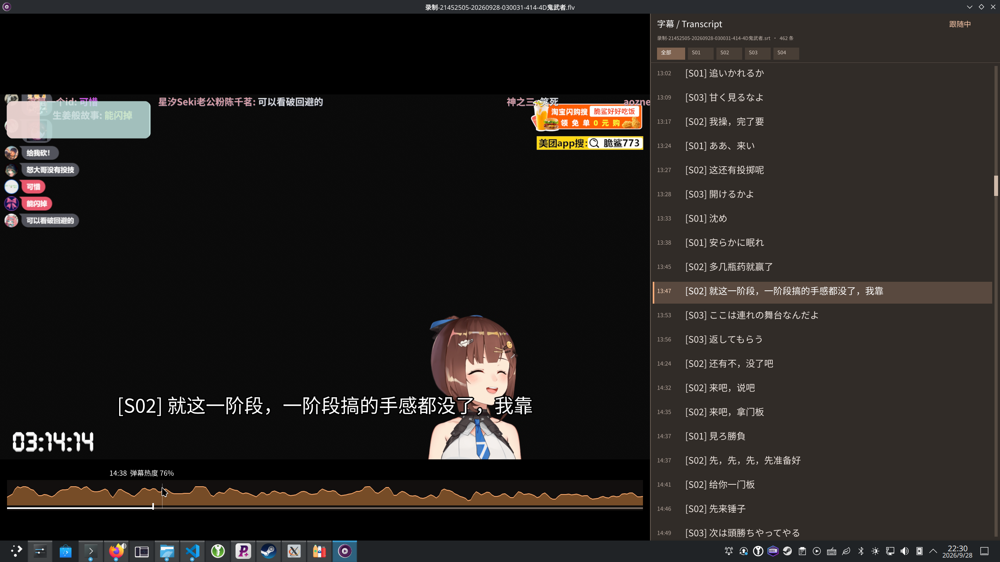

# BiliRecPlayer

本人的录播本地字幕生成与播放一条龙解决方案 (Linux Desktop Only)

用于处理和观看本地录播：将 FLV 的语音识别结果保存为 `diarized_json`，生成 SRT 字幕，将 XML 弹幕转换为 ASS，并用 mpv 同时显示弹幕、字幕侧栏和弹幕热度图。



## 文件约定

同一段录播的文件应放在同一目录，使用相同的文件名主体：

```text
录播.flv   视频输入
录播.xml   弹幕输入
录播.json  语音识别结果
录播.srt   字幕
录播.ass   弹幕字幕
```

处理单个 FLV 时，只会转换与它同名的 XML；没有 XML 时仍可生成 JSON 和 SRT。播放时需要同名 ASS 和 SRT，热度图还会读取同名 XML；没有 XML 时播放器仍可运行，但没有热度曲线。

## 运行条件

- Python 3；Python 脚本只使用标准库。
- `ffmpeg`、`ffprobe`、`curl`：用于提取音频并请求语音识别服务。
- 本地 ASR 服务：`video-asr.py` 默认请求 `http://localhost:8000/v1/audio/transcriptions`，模型为 `OpenMOSS-Team/MOSS-Transcribe-Diarize`。服务需要接受 AAC 音频并返回带 `segments` 数组的 `diarized_json`。当前脚本要求输入视频的第一条音轨为 AAC。
- `DanmakuFactory`：默认使用项目目录下的同名可执行文件，将 XML 转成 ASS；默认配置为 `DanmakuFactoryGUIConfig-1080横屏.txt`。
- `mpv`：用于播放和加载两个 Lua 界面脚本。
- `notify-send` 可选，用于显示语音识别的桌面通知。

项目提供 ASR 服务的 Docker 构建与 Compose 配置，模型权重需由服务下载。若服务地址或模型不同，请修改 `video-asr.py` 顶部的 `API_URL`、`MODEL` 等配置。

## 启动 ASR 服务

项目提供的 `Dockerfile.vllm` 基于 vLLM 的 ROCm 镜像，Compose 配置需要可供容器访问的 AMD GPU 设备（`/dev/kfd` 和 `/dev/dri`），以及 Docker Compose。启动与当前 Python 转写流程配套的 MOSS 服务：

**硬件说明：**本项目的 MOSS ASR 服务示例仅在 AMD Radeon RX 9070 XT 上测试通过；运行时会完全占用该显卡的 16 GB 显存。其他显卡及显存配置尚未验证。

```bash
docker compose -f compose.vllm.moss.yml up -d --build
docker compose -f compose.vllm.moss.yml logs -f moss
```

服务监听主机的 `8000` 端口，启动完成后再运行录播处理命令。停止服务：

```bash
docker compose -f compose.vllm.moss.yml down
```

`compose.vllm.base.yml` 放置共用的构建、设备、缓存目录和端口配置；`compose.vllm.moss.yml` 启动 `OpenMOSS-Team/MOSS-Transcribe-Diarize`。模型缓存保存在项目目录下的 `models/huggingface/`，vLLM 缓存保存在 `vllm-cache/`。MOSS 镜像构建时还会应用长音频所需的 encoder batch 修补。

另有 Qwen3-ASR 的独立配置：

```bash
docker compose -f compose.vllm.qwen3-asr.yml up -d --build
```

它与 MOSS 配置都占用主机 `8000` 端口，不能同时按默认配置启动。当前 `video-asr.py` 和后续 SRT 流程使用 MOSS 的 `diarized_json` 与说话人字段，Qwen3-ASR 配置尚未接入这条处理流程。

## 快速开始

将同名 FLV 和 XML 放在同一目录，先启动本地 ASR 服务，然后运行：

```bash
python3 process-recordings.py /path/to/录播.flv
python3 play-with-transcript.py /path/to/录播.flv
```

第一条命令依次生成 JSON、SRT，并在存在同名 XML 时生成 ASS。第二条命令用 mpv 播放视频。也可以把文件管理器中的 FLV 交给下方的桌面入口处理和播放。

批量处理目录中的录播：

```bash
python3 process-recordings.py /path/to/录播目录
```

不传路径时，默认处理脚本所在目录。目录模式只扫描该目录的第一层，处理其中所有 FLV 和 XML，不递归处理子目录。

批处理会跳过有效的 JSON、非空 SRT 和非空 ASS。若 JSON 无效或为空，会重新运行 ASR；重新生成 JSON 后也会重新生成 SRT。某一步失败时会报告错误，已有的成功结果可在下次运行时复用。

## 桌面入口

运行安装脚本：

```bash
./install-desktop-entries.py
```

它会将项目中的三个 `.desktop` 文件复制到 `~/.local/share/applications/`，并将 `Exec=./...` 换成当前项目的绝对路径。移动项目目录后需重新运行安装脚本。

| 入口 | 打开方式 | 功能 |
| --- | --- | --- |
| `process-recordings.desktop` | 单个 FLV 或文件夹 | 生成 JSON、SRT、ASS，跳过已完成步骤 |
| `subtitle-sidebar.desktop` | 视频文件或文件夹 | 将视频或文件夹当前层所有 FLV 加入同一播放列表，加载同名 ASS 和 SRT，显示字幕侧栏与热度图 |
| `video-asr.desktop` | 视频文件 | 仅运行语音识别，生成 JSON |

若文件管理器没有立即显示新入口，可重新打开文件管理器或刷新桌面应用缓存。

## 播放器操作

`play-with-transcript.py` 支持 FLV、MP4、MKV、MOV 和 WebM。它将 ASS 作为主字幕、SRT 作为副字幕，并从 SRT 生成右侧字幕侧栏。播放时必须已有同名 ASS 和 SRT。

打开文件夹时，按文件名排序将当前层所有 FLV（含大写扩展名）加入同一个 mpv 播放列表，不递归子目录。也可以同时传入多个视频或文件夹；切换视频时加载各自同名的 ASS 和 SRT。

| 操作 | 功能 |
| --- | --- |
| `Shift+T` | 显示或隐藏字幕侧栏 |
| 点击“全部”或说话人按钮 | 筛选侧栏中的 `[S01]`、`[S02]` 等说话人字幕 |
| 侧栏内滚轮、右侧滚动条 | 浏览字幕 |
| `↑` / `↓` | 选择上一条或下一条字幕 |
| `Page Up` / `Page Down` | 侧栏整页翻动 |
| `Enter` / 小键盘 `Enter` | 跳到选中字幕的开始时间 |
| 点击字幕行 | 跳到该条字幕的开始时间 |
| 点击“回到当前” | 恢复跟随当前播放位置 |
| `Shift+H` | 显示或隐藏弹幕热度图 |
| 热度图上悬停、点击 | 查看该位置的时间与相对热度、跳转播放 |

方向键、翻页键和回车键在侧栏打开时由侧栏使用。热度图根据同名 XML 中的弹幕时间计算，展示的是相对热度。

## 单独使用转换脚本

```bash
python3 video-asr.py /path/to/录播.flv
python3 video-asr.py --segment-minutes 10 /path/to/录播.flv
python3 diarized_json_to_srt.py /path/to/录播.json
python3 xml-to-ass.py /path/to/录播.xml
```

`video-asr.py` 默认整段提交；`--segment-minutes` 可指定每段的分钟数（支持小数，必须大于 0）。分段模式会重新编码 AAC 以准确裁切，依次请求 API，再将时间戳转换到原视频时间并拼接为同一个 JSON。各段说话人编号会重新分配，跨段的同一位说话人可能有不同编号。

`diarized_json_to_srt.py` 默认保留 `[S01]` 等说话人标记；可用 `--no-speaker` 去掉。`xml-to-ass.py` 默认读取项目内的 DanmakuFactory 配置；可用 `--config` 指定其他配置，用 `--factory` 指定可执行文件，用 `--force` 覆盖已有 ASS。各脚本的完整参数可用 `--help` 查看。
